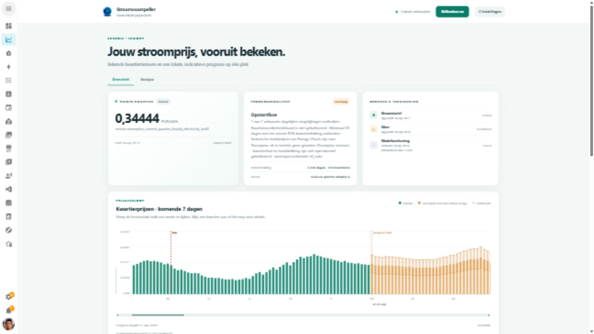

# Stroomvoorspeller voor Home Assistant

Een lokale Home Assistant App met een eigen Ingress-pagina voor bekende en voorspelde kwartierprijzen. De App leest de Home Assistant Core API, kan weersverwachtingen van Open-Meteo en historische Nederlandse marktprijzen van [Fraunhofer Energy-Charts](https://www.energy-charts.info/api.html?c=NL&l=en) ophalen, en bewaart keuzes, prijsarchief, invoersnapshots en modeluitkomsten op de installatie zelf onder `/data`. Er is geen apparaatbediening.



## Bron en status

De rekenregels zijn geïnspireerd door [`Mr-MIle/stroomvoorspeller` op commit `175a0ed975c409fbf9329a62687a7952ee745514`](https://github.com/Mr-MIle/stroomvoorspeller/commit/175a0ed975c409fbf9329a62687a7952ee745514). De gebruikte v4-berekeningen zijn voor deze App opnieuw geïmplementeerd en met vaste referentiegevallen vergeleken. Kwartierprijzen uit een gekozen tariefsensor zijn een andere doelgrootheid dan kale EPEX-prijzen in EUR/MWh. De methode en beperkingen staan in [MODEL.md](docs/MODEL.md).

Een prognose blijft **voorlopig** tot er minstens 35 dagen met 95% kwartierdekking én zeven volwassen dagelijkse voorspellingsruns met bruikbare evaluatie zijn. Een dagelijkse run vereist ten minste 92 van de eerste 96 voorspelde kwartieren met werkelijke prijs en een causale basislijn. Daarna heet de reeks **lokaal geëvalueerd** en toont de pagina de gemeten fout; dit is geen nauwkeurigheidsgarantie. De oorspronkelijke modelmarge is indicatief. Een aparte empirische kwartierband verschijnt pas nadat ook de kalibratie- en holdoutgrenzen zijn gehaald.

## Installatie en lokale bouw

Voeg `https://github.com/Timminater/timminaters-addons` toe als repository in de Home Assistant App-winkel. Vernieuw de winkel, kies **Stroomvoorspeller** en installeer of werk de App bij. De repository verwijst naar de versiegebonden multi-architectuurimage `ghcr.io/timminater/addon-stroomvoorspeller:0.2.9`. Controleer vóór installatie dat de GitHub Actions-build voor deze versie is geslaagd en de image publiek beschikbaar is. Dit document voert geen installatie in een live Home Assistant uit.

De Dockerfile is ook los te bouwen:

```sh
docker build -t stroomvoorspeller-ha-app:local .
```

In productie verzorgt Supervisor de toegang via Ingress op containerpoort 8099. Er is geen hostpoort ingesteld. Alleen beheerders zien de zijbalkpagina. `homeassistant_api: true` geeft de App toegang tot de officiële Supervisor-proxy. De backend gebruikt daarvan uitsluitend GET-verzoeken.

## Gebruik

1. Open na installatie de pagina **Stroomvoorspeller** in de Home Assistant-zijbalk.
2. Kies een tariefsensor. `sensor.zonneplan_current_quarter_hourly_electricity_tariff` is alleen een voorstel; de App controleert of de sensor op deze installatie bestaat.
3. Controleer prijsveld en eenheid. Als de sensor geen eenheid meelevert, kies die expliciet. De App leidt de eenheid nooit uit de getalsgrootte af.
4. Kies Open-Meteo of HA-weerentiteiten. De Home-locatie van deze HA-installatie wordt als voorstel ingevuld. Controleer die en sla Instellingen op voordat zij voor Open-Meteo wordt gebruikt; de App bewaart de bevestigde locatie lokaal.
5. Bekijk de horizontaal scrollbare tijdlijn met alle bekende en voorspelde kwartieren, de kwartiertabel, goedkoopste aaneengesloten vensters en het kwaliteitsblok. Een rode stippellijn markeert de huidige tijd. De grafiek begint bij nul, behalve wanneer negatieve prijzen of modelmarges voorkomen. Wijs een balk aan, gebruik het toetsenbord of tik erop om tijd, prijs en eventuele indicatieve marge te zien.
6. Gebruik **Bereken nu** voor een directe nieuwe modelrun. Onder **Instellingen** kies je het automatische controle- en berekeninterval: 5, 15, 30, 60 of 120 minuten. Bij een automatische cyclus rekent het model alleen opnieuw wanneer de invoer is veranderd. De Open-Meteo-bron blijft maximaal één keer per uur bevraagd.

Het aparte tabblad **Analyse** vergelijkt bewaarde prognoses met later gepubliceerde kwartiertarieven. Een dag vooruit gepubliceerd tarief telt mee zodra de app het ontvangt, ook als het kwartier zelf nog in de toekomst ligt. Het toont de fout per voorspelhorizon en recente kwartierparen. De analyse kiest per lokale dag één uitgegeven run, zodat een automatische run om de vijf minuten niet tientallen keren dezelfde dag laat meetellen. Nog niet gepubliceerde prijzen worden niet ingevuld. Een empirische band verschijnt pas wanneer voldoende eerdere, afzonderlijke dagen beschikbaar zijn; de getoonde dekking wordt op later uitgegeven voorspellingen gemeten. Tot dan blijft de grafiekmarge expliciet indicatief. De afzonderlijke rijpingscontrole voor historische, afgelopen kwartieren blijft strenger.

Optioneel kunnen **Home Assistant-entiteiten via MQTT** worden ingeschakeld in Instellingen. Hiervoor zijn een bereikbare MQTT-broker en de MQTT-integratie nodig. De app gebruikt de Supervisor MQTT-service en publiceert alleen prijs- en statusinformatie; apparaatbediening blijft buiten de app. Zonder broker blijft de prognosepagina werken en worden geen MQTT-entiteiten aangemaakt.

Bij uitval toont de App bewaarde prijzen met een verouderingsmelding. Een entiteitswissel wist het oude archief niet; de reeksen blijven per entiteit gescheiden. Alleen werkelijk bekende kwartieren komen in het kwartierarchief. Uurgemiddelden worden nooit opgesplitst in vier zogenaamde waarnemingen.

Bij een nieuw Zonneplan-archief zonder weekendhistorie kan het model de afgelopen 35 dagen Nederlandse marktkwartieren ophalen. Het leidt de tariefomrekening uitsluitend af wanneer minimaal 96 bestaande Zonneplan-kwartieren vrijwel exact op die marktprijzen aansluiten. De herleide oude prijzen voeden alleen het model: de grafiek en de nauwkeurigheidsmeting blijven echte HA-tarieven onderscheiden van deze aanvulling. De pagina vermeldt de herleiding als voorlopige modelbasis. Bij ontbrekende marktdata of een mislukte vergelijking blijft de eerdere, eveneens voorlopige dagtypeproxy actief. Historische contractwijzigingen zijn niet automatisch te verifiëren.

Je kunt nu ook **Energy-Charts Nederland** als zelfstandige marktbron kiezen, zonder Zonneplan-integratie. Kies kale EUR/kWh of configureer een gedateerde all-in afnameprijs; bron, componenten en geldigheidsdatums krijgen aparte archief- en modelidentiteiten. De bestaande Home Assistant-entiteit blijft beschikbaar. Zie [Prijsbron en tariefcomponenten](docs/PRICES.md) voor de instellingen-API, bronvermelding en MQTT-sensoren.

## Ontwikkelcontrole

Gebruik een repository-lokale basetemp:

```sh
python -c "from pathlib import Path; Path('.pytest-tmp').mkdir(exist_ok=True)"
pytest --basetemp .pytest-tmp/DEV-003 tests
```

De point-in-time evaluatie in `app/backtest.py` rekent met bewaarde invoersnapshots. Zij mag geen achteraf gemeten weer als modelinvoer gebruiken. Zonder voldoende volwassen lokale data rapporteert de App geen bewezen nauwkeurigheid.

Na opbouw van het archief kunnen de fouten per horizon lokaal worden bekeken:

```sh
python -m app.backtest --data-dir /data --entity-id sensor.zonneplan_current_quarter_hourly_electricity_tariff --price-field tax_included --tariff-unit EUR/kWh
```

De uitvoer bevat MAE en bias over alle gerealiseerde voorspellingen (`n`). Vergelijk `paired_model_mae` met `baseline_mae`: beide gebruiken precies de `paired_n` kwartieren waarvoor ook een causale basislijn bestaat. Waar berekenbaar vergelijken `window_regret` en `baseline_window_regret` de vensterkeuzes op dezelfde gerealiseerde kwartieren. `band_coverage` blijft leeg zolang er geen lokaal gekalibreerde kwartierband is.

## Herkomst en privacy

Zie [architectuur](docs/ARCHITECTUUR.md), [model en afwijkingen](docs/MODEL.md) en de [officiële communicatie](https://developers.home-assistant.io/docs/apps/communication/) en [App-configuratie](https://developers.home-assistant.io/docs/apps/configuration/) van Home Assistant. Deze App gebruikt geen GitHub Actions, Vercel, publieke `ha.json` of opslag van persoonsgegevens buiten de installatie. Bij keuze voor Open-Meteo verlaten alleen de gekozen coördinaten en de benodigde weerquery de installatie.

## Rekenmethoden en historische vergelijking

Onder Instellingen kun je **Lokaal adaptief**, **Oorspronkelijke v4**,
**EpexPredictor NL** en **Timestral** afzonderlijk in- of uitschakelen.
Alleen Lokaal adaptief staat standaard aan. Kies één actieve methode voor de
grafiek en MQTT; ingeschakelde alternatieven bewaren hun eigen prognoses.

Onder Analyse vergelijk je live resultaten en kun je beschikbare bestaande
kwartierhistorie handmatig laten terugrekenen, zonder historische en live scores
te vermengen. Alle methoden rekenen in de add-on. Timestral biedt keuze uit 5M, 28M, 123M en 209M (nieuwe installaties: 28M; bestaande 209M behouden) en vereist een afzonderlijk bevestigde modeldownload; er is geen externe rekenservice nodig.
Zie [methoden, resourcebeheer en historische tests](docs/METHODS.md) voor installatie,
tariefomrekening, beperkingen en licenties.


De leverancierskeuze bevat 25 lokale tariefvoorstellen uit [Tweakers, eerste post](https://gathering.tweakers.net/forum/list_messages/2049754), peildatum 4 augustus 2026. Zowel EpexPredictor naar HA als Energy-Charts all-in gebruikt dezelfde opslagen inclusief btw. Controleer je contract; componenten, toepassingsperiode en Eigen tarief worden toegelicht in [PRICES.md](docs/PRICES.md). Bestaande opgeslagen componenten blijven behouden.


Onder **Opslag** zie je hoeveel ruimte database, modellen en cache gebruiken. Je kunt oude gegevens op leeftijd verwijderen, de Epex-cache legen en ongebruikte Timestral-modellen verwijderen. Via **Download analyse-export (ZIP)** kun je prijzen, prognoses en modelinformatie lokaal downloaden om zelf te delen voor onderzoek naar betere voorspellingen. De export verwijdert tokens, coördinaten en oorspronkelijke entiteitsnamen. Zie [opslag en export](docs/DATA.md) voor inhoud, beperkingen en API.


Lokaal adaptief v2 valideert voor de horizon 24–48 uur ook de mix met v4 op eerdere voorspelfouten. De historische test rekent nu 48 uur door en toont resultaten per horizon. Zie [modelonderbouwing en beperkingen](docs/METHODS.md#lokaal-adaptief-v2-gevalideerde-mix-voor-2448-uur); het gemeten voordeel uit één export moet nog live worden bevestigd.


**Overzicht** toont de geselecteerde methode en de daadwerkelijk getoonde modelversie bij de grafiek. Goedkoopste momenten zijn altijd zichtbaar, met weekdag bij begin- en eindtijd. Aanvullende bron- en kwaliteitsdetails zijn uitklapbaar. **Analyse** vergelijkt live of historische prestaties met foutbalken, tarieflijnen en dagelijkse fouten; kies methoden, periode en horizon. De grafieken gebruiken dezelfde uitgiftetijd en doelkwartieren. Ontbrekende gemeenschappelijke resultaten worden zichtbaar gemeld. Opslag en export staan op **Data & opslag**.

Timestral krijgt standaard expliciete zaterdag/zondag-informatie in Nederlandse tijd. De optie is onder Instellingen uit te zetten voor vergelijking met de oorspronkelijke prijsreeksvariant. Dit is geen vaste weekendkorting of garantie op lagere/betere tarieven. De score- en kalibratiereeksen blijven gescheiden. Zie [Timestral-weekendinformatie en modelvergelijking](docs/METHODS.md#weekendinformatie-en-visuele-modelvergelijking).
